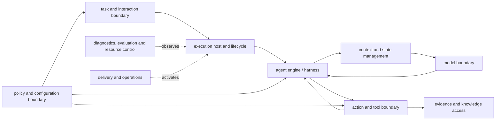

# Architecture: responsibilities and boundaries

Choose the smallest implementation that meets the target outcome, permitted authority, failure tolerance, data lifecycle and evidence needs. The columns describe logical ownership, not a mandatory service diagram. Extended forms are conditional choices; their pressure must be explicit.

## Architecture trade-off ladder

These are recorded design judgments for selecting the smallest system that satisfies the agreed workload, not measured rankings of architectures. State the pressure, the sacrificed property and the check that would justify moving to the more complex option; keep required authority, privacy and failure guarantees fixed.

| Need and choice | Gain, cost and reach order |
|---|---|
| Known order versus adaptive decisions | A coded workflow is predictable and cheap to validate when the order is known. A bounded agent loop buys dynamic choice at model-call cost, variable caller latency and termination/checking work; children can add isolation or specialization but also briefing, joins, failure propagation and parent verification. Keep fixed steps deterministic, add adaptation for real decisions, and delegate only when separable work or isolation pays those costs. |
| Co-located responsibilities versus separate services | One process or shared store can preserve explicit contracts with fewer hops, simpler atomic work and less operating overhead. Independent services buy separate ownership, scaling or failure containment at transport, consistency, deployment and observability cost. Keep contracts explicit now, and distribute only for a named requirement rather than one service per responsibility. |
| Short request versus durable execution | A direct invocation using only volatile state minimizes coordination but loses recoverable progress after process failure. Durable intent, checkpoints and recovery buy required continuity at storage, commit, fencing and reconciliation cost; a queue adds scheduling delay when the chosen execution design needs one, while synchronous delivery can still use durable state. Replay without effect identity can duplicate an uncertain operation. Start with a direct invocation when sufficient, and add only the persistence, scheduling and recovery guarantees the target workload requires. |
| Fresh isolated work versus retained state | Stateless or in-memory work limits stale and sensitive residue but loses continuity at the end of its lifetime. Persisted state and cross-session memory can recover progress or avoid rediscovery, at schema, provenance, correction, retrieval-staleness, access, retention and forgetting cost. Retain only what the agreed horizon needs, preserve indispensable constraints independently of fallible summaries, and qualify recovery and correction rather than assuming model continuity. |
| Local adapters and constants versus shared control infrastructure | Direct adapters and validated constants avoid extra hops and dependencies. A gateway or independently managed configuration can centralize custody, routing, accounting or policy changes, at availability, compatibility, version-freshness and activation-proof cost. Add the shared layer for those actual obligations; multiple providers alone do not require a gateway, and a committed setting alone does not prove a run used it. |
| Complete slice versus broad generality | One complete request path gives fast feedback and a concrete verdict, but proves only its exercised requirements. General infrastructure buys future flexibility at abstraction, integration and ongoing test/maintenance cost. Build the smallest end-to-end slice, include the failure and continuity guarantees already required by the agreed workload, then extend for demonstrated pressures; small present traffic does not waive a fixed target requirement. |

Build the selected architecture as modules connected by a composition root outside generic core algorithms, with capability plugins obeying the independence contract in [agent engine and harness](../../agent-harness-model-and-tools/references/agent-engine-and-harness.md): a workflow function calls known steps, and a bounded agent loop selects only the steps that need adaptation. Wire model adapters, tool executors, context assembly, configuration resolution and host lifecycle through explicit inputs and results in one process first. For the first complete slice, write an integration test that invokes this assembled path and checks both the user-visible result and the required failure or recovery behavior; add service endpoints, child-run launchers or durable workers only for the selected pressures.

## Component responsibilities

| Component | Owns | Does not own | Needed when | Minimal form | Extended form and pressure |
|---|---|---|---|---|---|
| task and interaction boundary | Admission of user calls, queued events and scheduled triggers; desired outcome, caller authority, cancellation and result delivery | Execution decisions and tool authorization | Any admitted task | Validated function or CLI input and response | Durable event admission, streaming and reconnect when callers disconnect or tasks outlive connections |
| agent engine / harness | Selects model, observation, action, completion or delegation steps and bounds work | Host liveness, external authority, provider protocol | Agent selects steps | Bounded loop with explicit termination | Child orchestration when specialization or isolation warrants it |
| model boundary | Request/response conversion, tool-call fidelity, streaming, limits and usage | Action permission and context ownership | Model call | Adapter per route | Gateway when shared routing, credential custody, per-attempt accounting or policy justify its operating cost; multiple providers alone do not require one |
| context and state management | Information entering calls, provenance, size admission, continuity, loss policy and state semantics | Scheduling, provider execution and authorization | Every model call needs context | In-memory request assembly | Persistence when continuity must survive execution; compaction when retained context exceeds a safe budget; prompt-cache layout when reuse is supported and worthwhile; cross-session memory when later tasks need retained information and correction, provenance and forgetting have owners |
| action and tool boundary | Schema, validation, authorization, execution, truthful result and effect semantics | Model's choice of next step | External or local actions | In-process validated function | Remote protocol, operation journal or approval when separation or effect risk requires it |
| execution host and lifecycle | Scheduling and liveness: start, stop, deadline, concurrency and completion | Deciding the next model step or semantic state | Any execution | Synchronous process and cancellation | Durable jobs when work must outlive a process; leases, heartbeats and recovery when replaceable workers require ownership and liveness detection |
| evidence and knowledge access | External data access, lineage, visibility and grounding | Authority creation or inventing facts | Task needs external evidence | Read a file, SQL row or search API under caller authority | Owned corpus and ingestion when the product must maintain source lifecycle; indexing when measured access needs justify it; vector service is one option |
| policy and configuration boundary | Trusted settings, effective version, validation and compatibility | Enforcing every downstream decision by itself | Any governing policy, including constants | Validated constants | Versioned configuration service and invalidation when authorized independent changes, freshness or multiple consumers require them; a file or immutable version can suffice |
| diagnostics, evaluation and resource control | Observe inputs, actions and outcomes; diagnosis, regressions, cost and latency | Replacing authorization or fabricating missing usage | Any system needs a credible check | Local records and deterministic checks | Traces and accounting when operational visibility or attribution demands them; an atomic monetary hold or equivalent with a verified conservative liability bound when a hard spend limit is required; controlled experiments when comparative behavior is uncertain |
| delivery and operations | Version, activation and revision-to-run evidence | Semantic correctness of code or config | Changes run outside the author's immediate process | Record code and effective settings for a local run | Release, activation and rollback evidence when environments or components ship independently |

## Trust and privacy across the map

Name a threat-model owner, principals, protected resources, data carriers and allowed effects. Verify trusted authority at admission and again at the enforcing action or evidence boundary; a model's proposed arguments and retrieved content are untrusted. Limit, redact and retain data according to the actual policy across prompts, results, streams, logs and persisted derivatives. If deletion or forgetting is required, fence in-flight writers before deleting or invalidating derived copies; test that an old writer cannot restore them. A classifier is a signal, not an authority boundary.

## One request

Admission supplies the desired outcome and verified authority to the host; policy supplies effective settings. The host starts a bounded harness; context constructs a provenance-aware request and admits it to the model boundary. The model returns text or a proposed action; the harness selects the next step, and the action boundary validates and authorizes the proposal before execution. Evidence access supplies scoped results and failures when needed. The harness produces a completion; the host records or returns it and diagnostics ties evidence and resource usage to the work. The interaction boundary renders the result. Follow [system flows](system-flows.md) for failure paths and recovery.

## Simpler premises

For a short local CLI that can fail when its process exits, host and interaction can be function calls; there is no queue, lease, durable checkpoint, reconnect, gateway or deployment control plane. If no external evidence or action is needed, omit those calls while retaining the relevant interfaces in the design. A fixed document workflow may use deterministic steps in place of an open agent loop. A hosted assistant can add identity isolation, external search and persistence only where its workload and trust requirements demand them. Separation of contracts still matters within one process.

## Human mechanism and its limits

People doing complex work use external notes and explicit hand-offs to reduce reliance on working memory; a task record and a context projection can serve an analogous role. Unlike a person, an agent's model call does not inherently retain prior state or guarantee that a summary preserves it. Therefore specify what is carried, lost and checked rather than assuming human-like continuity; use the [context chapter](../../agent-context-and-state/references/context-and-state-management.md) for the contract.
